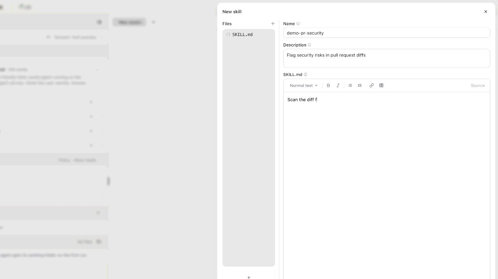
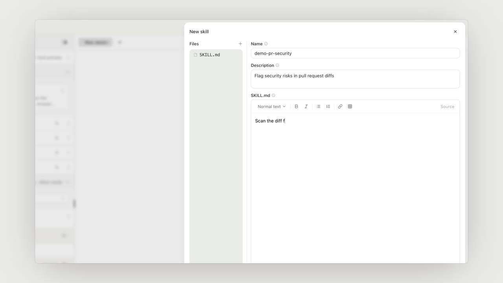

# One-take reels and the Agenta reel brand pack

Design and requirements: `openspec/changes/one-take-reel-and-agenta-brand/`.
This file records what the validation render measured and where the frozen
`agenta@2` numbers came from.

## Validation render

`reels/skills-onetake.brief.json` (gitignored): house `agenta@2`, demo
`skills-launch` (the Skills take recorded on demo-agent, Agenta v0.122.8),
title "Introducing ==Skills==", one outro line. `pnpm launch skills-onetake`:

| | 16:9 | 9:16 |
| --- | --- | --- |
| length | 27.27s (max 40s) | 27.27s |
| segments | title 1.67s · take 22.40s · outro 2.00s · logo 1.20s | same |
| meanShotS / cutsPerMin | 13.63 / 2.2 | 9.09 / 4.4 |
| movingFrac / longestStillF | 0.170 / 192 | 0.220 / 157 |
| caps | none (one take is never capped) | none |
| brand audit, static | 0 problems | 0 problems |
| brand audit, frames | 0 problems | 0 problems |

The one-take style has no reference film, so the motion metrics are reported,
not gated (`targets: null`, as classic). `analyze`'s own footage-onset check
flags the take's first camera move (37% of peak on its first frame): the take
opens mid-approach to "Add skill" because of the 0.2s lead. It is analyze's
heuristic for cut-in shots, not a house gate, and is left as is.

## Seeds

All `agenta@2` cut numbers are `agenta@1`'s measured stage cut (see
`docs/reel/design/compiler-validation.md`), except:

| field | value | why |
| --- | --- | --- |
| `cut.payoffTailS` | 1.2 | the take's pull-back after its last action; the stage tail that passed the golden run |
| `cut.typingCapS`, `cut.clipCapS` | 60 | one take is never cut by a beat cap; `maxLengthS` is the guard |
| `maxLengthS` | 40 | skills take 22.4s + cards 4.9s = 27.3s, with room for a two-action take |
| `outro.max` | 3 | the brief's closing lines, one card each |
| `gate.brand.tolerance` | 12 RGB units | worst card frame 0.275% off-palette at 12 (16:9), 0.110% (9:16); 0.551% at 6, 0.383% at 8 |
| `gate.brand.maxOffShare` | 0.5% | ~1.8x the worst measured; an off-brand ground or subhead covers far more |

Frozen at hash `43819b7b3d669dff` (`src/lib/house.test.ts`) and made
`HOUSE_DEFAULT`. A brief that pins `agenta@1` or `agenta-classic@1` compiles
exactly as before.

## Known

- The `skills-launch` take was recorded with leftover `demo-pr-security` copies
  in the account's skills library, and they show in the library list
  mid-take. Delete them in Agenta before the next take.
- `camera-logs.test.ts` flags that take: the camera loses the caret during
  "name the skill" at 12.24s. It predates this change (it is the recording,
  not the cut), and one take shows it.

## Smoothness (agenta@3)

Measured on the skills take at 4K capture, on a loaded machine (load 5-9 on 8
cores):

- **Capture cadence.** Headless Chromium encodes every 3840x2160 frame, so it
  delivered ~33 distinct fps in motion, held unevenly (16 ms / 50 ms): the
  judder on drawers, menus and typing. The same flow at 1920x1080 got 814
  distinct frames to 4K's 355. Slow-motion shooting (`DEMO_SLOWMO`, K=3)
  raised motion outside typing from ~34 to ~38 distinct fps, and to 46 on the
  public example flow.
- **Camera.** Moves were priced by focal travel, so a re-frame at 1.74x crossed
  ~750 px of screen in 0.71 s (~1 px/ms, twice the reference). Priced by
  on-screen travel (`moveDuration`, src/lib/camera.ts), the big moves take
  0.9-1.4 s: peak speed down ~25% (152 -> 115, 169 -> 139 px/frame at 1920),
  sharpest acceleration step down ~40% (51 -> 30, 55 -> 40). Demos rendered
  before this run a few frames short of the new track (agent-tool: 425 vs 432)
  and warn until re-rendered.
- **Output rate.** 60fps doubles every camera, cursor and card step. The 60fps
  16:9 one-take reel rendered in 39 min end to end (demo plus reel) on this
  machine.

`agenta@3` = `agenta@2` + `shoot.slowmo: 3` + `fps: 60`, frozen at hash
`c242ede045a7c5cc` and made the default.

`agenta@4` = `agenta@3` with `aspects: ["16:9"]` (the vertical cut dropped from
the default at the user's request), hash `89c841e6ef27df1f`.

## The window on a grey ground (agenta@5)

Under `agenta@4` the app read as full screen: its window floated on White smoke
`#F6F5F3`, nearly the app's own background, and the camera scaled the whole
window, so any punch past 1 / 0.86 pushed the window's edges and the ground out
of shot. That was most of the take.

`agenta@5` adds a house `window`: the ground is a pack colour, and the camera
works **inside** the window (`ShotStyle.camera: "inside"`, src/DemoClip.tsx).
The window holds at `windowFit` 0.86 and the app moves within it. The camera
is framed for a window that is its whole view (fit 1), so the app is magnified
by exactly what `agenta@4` gives it (0.86 x pose scale), and the ground, the
rounded corners and the shadow stay in every frame.

The ground is neutral 200 `#EBEAEA`, a touch darker than the reference the
user pointed at (Cursor's canvas launch, `#F5F5F7`). Neutral 300 `#D7D7D7`
was tried first and read too deep. The cards stay White smoke. The static audit
checks the window ground against the pack (`window.ground`); the frame audit
still samples cards only.

**The pink.** The app's greys rendered pink: footage `#F2F0EE` came out
`#F8F0F0`, `#F6F4F2` came out `#FFF8F8`. The cause was the shutter, not the app
or the encode (ffmpeg decodes the mp4 to within two levels of the recording).
ShutterBlur sums 8 samples at 1/8 opacity, and every composite rounds to 8 bits,
so every channel lands on a multiple of 8 (src/lib/shutter.ts, groupsFor). A
near-grey's three channels round different ways, which flips its hue, and the
product grade's saturate pushes it further. Measured identically on `angle` and
`swiftshader`, and with the grade off (`#F8F8F0`).

Under the `inside` camera the shutter wraps only the app, which is opaque in
every sample, so it AVERAGES them instead (`blend: "average"`: sample i drawn
over the others at opacity 1/(i+1)). Identical samples composite exactly, so a
hold renders the footage's own colours (`#F2F0EE` -> `#F5F3F2` with the grade);
a moving frame is off by a level or two. The rosy skeleton bars (`#F1EEED`) and
the green-grey Files panel (`#E5E6E3`) are the app's own colours.

The window-camera path (`agenta@4` and older, every demo) still sums, so its
page white still renders 248; changing that would change every published render.

Frame 888 of the skills take (typing the SKILL.md body):

| `agenta@4` | `agenta@5` |
| --- | --- |
|  |  |

`agenta@5` = `agenta@4` + `window: { ground: "neutral-200", camera: "inside" }`,
hash `3b4a2165b28cba9e`, the default.

### The inside camera's framing, and the typing sound

The first `inside` camera framed the track for a window that was its whole
view (fit 1). The window is only 0.86 of the frame, so every zoom showed 14%
less of the app than `agenta@4`, and the slide-in skills list and the New skill
drawer came out cropped. It now runs `agenta@4`'s own track and shows, inside
the still window, exactly the part of the app `agenta@4`'s frame showed
(`insideCss`, src/lib/camera.ts): the whole app while that camera shows the
window on its ground, the same view once it fills the frame. The app is drawn
at 0.86 of `agenta@4`'s size; nothing it framed is cropped. Both limits are
soft: a hard `max(1, scale)` and a hard pan clamp held the view still while
`agenta@4` showed ground, then started every punch at full speed (footage move
onset 17% of peak on the first frame, against 1% under `agenta@4`). Scale now
passes a softplus knee and pan a tanh knee, so moves ease in as before.

The typing sound was the whole 3s `typing.wav`, placed on the press. A name
typed in ~0.55s kept clacking for 2.5s after it, and the SKILL.md body (~5.7s)
went quiet halfway. A typing cue now starts at the first keystroke on screen
(the first caret probe + `TYPING_SHOWN_MS`, 150ms, measured) and lasts to the
last one, the sample played back to back and faded over 80ms at the end
(`sfxPieces`, src/lib/reel-audio.ts).

## Focus framing, a wide opening and a poster (agenta@6)

Reviewed on the `agenta@5` skills take: it opened pushed in (the camera left
for Add skill 0.9s into the footage, the clip started at 1.67s), the skills
list slid in under a camera framed on the menu for a second, and the form held
one pose at 1.07x on screen through three fields and six seconds of typing.

- **Focus framing** (`FrameGeometry.focus`, src/lib/zoom.ts), for the `inside`
  camera only, which is framed at fit 1 (the window is its view) instead of
  through a remap of the window camera (`insideCss`, removed). A typing beat
  frames its field at up to 90% of the view, so typing holds at 1.5x on screen,
  the 4K capture's ceiling; any other beat with a populated region frames all
  of it, loosening to the whole app, so a drawer that opens is shown whole; and
  the camera leaves for the next beat once the last has been watched, not when
  the cursor departs. On the skills take: wide, 1.32x on Add skill, the whole
  app as the list opens, 1.5x on Name, Description and the SKILL.md body
  (following the caret), the whole form for Create.
- **Wide opening** (`House.opening`): the clip starts 0.05s into the footage
  (frame 0 decodes as @remotion/media's magenta placeholder), so the take opens
  on the whole app and its first zoom plays on screen.
- **Poster** (`House.poster`, `IntroStoryboard.poster`): the title card is
  built on its first frame (every word, the wordmark, the pill), so the reel's
  frame 0, which X and LinkedIn show before play, is the title. The launch
  writes it as `out/reel/<name>.poster.jpg`.

`agenta@6` = `agenta@5` + `opening: "wide"` + `poster: true`, hash
`635543c76ec5dea2`, the default.
